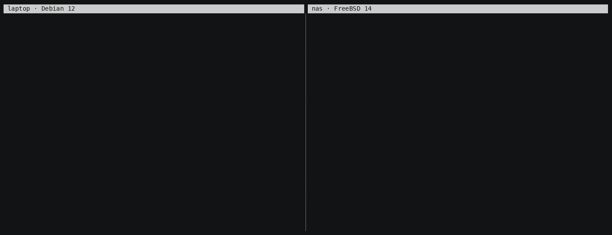

# juist

A peer-to-peer mesh VPN in the spirit of Tailscale, with **no coordination
server at all**, neither a vendor's nor your own. WireGuard carries the traffic.
Who belongs to the network is a log signed by your admins, and every device
checks that log for itself.

- **Nothing to run or trust in the middle.** Devices find each other on the
  LAN, through each other, or through the public BitTorrent DHT. They punch
  through NAT and fall back to a relay that one of your own devices runs.
- **Changes need your admins.** Admitting or removing a device takes a k-of-n
  quorum of admins, each with a key on their own devices. The keys stay in your
  keystore; the daemon never holds them.
- **Fail-closed, where you want it.** Once you name vouchers, always-on
  devices that vouch hourly, a device that too few of them have vouched for
  in 48 h keeps tunnels only to vouchers, so it cannot carry a removed device
  along indefinitely.



juist runs on Linux and FreeBSD, and an app makes an Android phone a member.
It has not had a security audit yet.

The [handbook](https://docs.juist.nning.io/en/docs/) explains every feature step by step;
`juist help COMMAND` and `man juist` say what each command does.

## Install

On every device:

```sh
make install     # builds the .deb (Debian, Ubuntu) or the RPM (Fedora) and installs it with sudo
gmake install    # on FreeBSD, as root: builds the package and installs it with pkg
```

The package brings `juist`, the command, and `juistd`, the daemon, with shell
completion and man pages. Building a package for another machine, and
FreeBSD's service: [Install](https://docs.juist.nning.io/en/docs/install/).

## Your first network

On the first device, as yourself:

```sh
juist create          # a new network, named like "belfast-hazardous"; asks for sudo once
juist invite          # prints a code and a link, then waits for the new device
```

On the new device:

```sh
sudo juist join 42-drumbeat-tolerance-glucose    # the code: same LAN
sudo juist join 'juist:Kx7…@192.168.1.20:41642'  # or the link: from anywhere
```

`juist invite` shows four words and asks whether the new device shows the same
ones. Answering yes admits it. Then, on either device:

```sh
juist status          # connected? anything wrong?
juist devices         # who is in the network, with their addresses
ping 198.18.36.2      # the second device, at the address juist devices lists
```

Behind NAT nothing needs opening in a firewall; a device with a public address
needs 41643/udp. More in [Your first network](https://docs.juist.nning.io/en/docs/first-network/)
and [Invites](https://docs.juist.nning.io/en/docs/invites/).

## Everyday use

| To … | run | more |
|---|---|---|
| see whether this device is connected, and what needs attention | `juist status` | [status](https://docs.juist.nning.io/en/docs/status/) |
| add a device | `juist invite`, then `sudo juist join …` on it | [invites](https://docs.juist.nning.io/en/docs/invites/) |
| remove a device, on every device at once | `juist remove phone` | [remove](https://docs.juist.nning.io/en/docs/remove/) |
| reach a device by name, where systemd-resolved runs | `ssh laptop.home.juist`, or `ssh laptop` | [names](https://docs.juist.nning.io/en/docs/names/) |
| let a device with a public address relay for the others | `juist grant vps relay` | [relays](https://docs.juist.nning.io/en/docs/relays/) |
| send this device's internet traffic through another | `juist grant vps exit`, `juist exit serve` there, `juist exit use vps` here | [exit nodes](https://docs.juist.nning.io/en/docs/exit-nodes/) |
| let every device reach the LAN behind one | `juist subnet add nas 192.168.1.0/24`, then `juist subnet serve` on it | [subnets](https://docs.juist.nning.io/en/docs/subnets/) |
| publish a service on the internet, or share a file | `juist publish add immich 127.0.0.1:2283`, `juist share ~/photos` | [publishing](https://docs.juist.nning.io/en/docs/publishing/) |
| rename or renumber the network, or rename a device | `juist network rename office`, `juist network renumber 10.7.0.0/22`, `juist rename phone tablet` | [changes](https://docs.juist.nning.io/en/docs/network-changes/) |
| see every change, and who approved it | `juist log` | [admins](https://docs.juist.nning.io/en/docs/admins/) |
| manage this device without sudo from now on | `sudo juist set --operator=$USER` | [operator](https://docs.juist.nning.io/en/docs/operator/) |
| give this device new keys | `juist rotate` | [keys](https://docs.juist.nning.io/en/docs/keys/) |
| back an admin key up in a password manager | `juist admins export alice@home \| pass insert -m juist/alice` | [keys](https://docs.juist.nning.io/en/docs/keys/) |
| end the network for good, with a break-glass secret | `juist network disable` | [changes](https://docs.juist.nning.io/en/docs/network-changes/) |
| leave the network, as on a fresh install | `juist reset` | [remove](https://docs.juist.nning.io/en/docs/remove/) |

Any local user may run `juist status`; everything else is for root and the
device's operator. Commands never ask which network or device you mean: where
that is unclear they stop and say what to add.

## Publishing services

A device's service, such as Immich on a NAS at home, can be reached from the
internet by name through an **ingress**: a device with a public address that
passes connections through the tunnel. TLS ends on the device, never at the
ingress.

```sh
juist network domain pub.example.org    # DNS: *.pub.example.org points at the vps
juist grant vps ingress                 # then juist ingress serve, on the vps
juist publish add immich 127.0.0.1:2283 # on the nas: https://immich.pub.example.org
juist publish add nas mc 25565 --tcp    # a service without TLS on a port of its own: mc.pub.example.org:25565
juist share ~/photos/2026               # with the publish role: a directory under this device's name
```

Each step names the next and the device it is run on.
[Publishing services](https://docs.juist.nning.io/en/docs/publishing/) has the rest:
shares, the status page, and a service member that keeps a published server
in Docker from the rest of the network
([examples/service-member](examples/service-member)).

## Android

The app, for Android 12 or newer, joins one network as a member by scanning
the QR code `juist invite` shows in a terminal, or by the code typed in on the
same LAN. While its VPN is on, every app on the phone reaches the other
devices at their addresses; the phone's other traffic and its DNS are left
alone.

```sh
make android    # needs a JDK 21, the Android SDK and NDK; the APKs land in android/app/build/outputs/apk
```

It sends its internet through an exit node where one is chosen; it resolves
no names, uses no subnets, and takes no roles.
Building, signing and what the app shows: [Android](https://docs.juist.nning.io/en/docs/android/).

## Several networks and several admins

A device can be in several networks at once, each with a juistd of its own;
a command about one takes it first, by name: `juist invite work`. See
[Several networks](https://docs.juist.nning.io/en/docs/networks/).

An admin is a person, with a key on each device they approve from. More admins
and a quorum make every change need more than one of them:

```sh
juist admins add bob nid:…      # once per device of bob's
juist grant nas voucher         # carries changes waiting for votes
juist admins quorum 2           # every change needs alice and bob
juist approve                   # on a voucher device: asks about each change waiting for your vote
```

[Admins](https://docs.juist.nning.io/en/docs/admins/) covers a second laptop's key, one
key per network, approving offline and upgrading the log;
[Keys](https://docs.juist.nning.io/en/docs/keys/) what to keep where. Losing every key
of the admins a change needs locks the network for good.

## Relays, ports and firewalls

Two devices that cannot reach each other directly relay through a member that
has a public address, never through a third party.

| Port | For | Open it where |
|---|---|---|
| 41643/udp | WireGuard and path discovery | a device with a public address |
| 41645/tcp, 41645/udp | the relay, and the STUN answers members measure it by | a device granted `relay` |
| 41642/tcp | an invite taken as a code on the LAN | the inviting device, while `juist invite` runs |
| 443/tcp, 443/udp, 80/tcp | the names devices publish, by TLS and QUIC | a device granted `ingress`; `juist ingress serve` opens them |
| the ports names are published on by TCP | those names | every ingress; it opens and closes them as they come and go |

The packages install ufw and firewalld profiles by the names `juist`,
`juist-relay`, `juist-invite` and `juist-ingress`. Log sync runs inside the
tunnel, on TCP 41644 on `juist0`, which a firewall configured by hand must let
in. [Relays and ports](https://docs.juist.nning.io/en/docs/relays/) has the rest:
further networks' ports, and running without public STUN servers or the DHT.

## When something is wrong

`juist status` says what needs attention, and prints a hint to fix it;
`journalctl -u juistd` shows the daemon's log.
[Troubleshooting](https://docs.juist.nning.io/en/docs/troubleshooting/) lists what each
message means and what to do.

## Security, in short

- **Trust root:** the log's genesis and a k-of-n quorum of admins. There
  is no coordinator. Every record is verified by every device, and the
  transport is untrusted.
- **Key custody:** admin keys live in the operator's keystore
  (`~/.config/juist`). juistd runs as its own user with `CAP_NET_ADMIN` only,
  and holds no admin key.
- **Invites:** SPAKE2 (RFC 9382). A code admits exactly one guess, from the LAN
  only, and a link is a 128-bit secret.
- **Revocation** is eventually consistent; the freshness TTL (48 h) bounds how
  long a partitioned device can keep a removed peer.
- **Post-quantum:** group secrets are hybrid X25519 + ML-KEM-768. WireGuard
  traffic is not hedged yet. Signatures are Ed25519.

[Security](https://docs.juist.nning.io/en/docs/security/) explains it, and
[02-threat-model.md](docs/02-threat-model.md) lists every residual weakness.
Report a vulnerability privately, as [SECURITY.md](SECURITY.md) says.

## Status

Milestones up to **M9**, publishing, of [05-roadmap.md](docs/05-roadmap.md)
are done: the signed log with quorum, WireGuard with NAT traversal and member
relays, invites, several networks, exit nodes, subnet routers, names,
publishing, and Debian, Fedora and FreeBSD packages; **M11**, TCP
services and HTTP/3 through the ingress; and **M12**, ending a network with a
break-glass secret and backing admin keys up.

Not yet: ACLs (every member reaches every port on the others), and the
post-quantum data plane.

## Development

Go 1.27; `make` fetches and uses go1.27.2, so that a commit builds to the
same bytes anywhere, and lists the targets.

```sh
make check                      # what CI gates on: lint, tidy, race tests, TCB budget
sudo -E make test-os-plumbing   # real TUN devices, namespaces, the NAT matrix (root)
make build cross deb rpm        # binaries, all platforms, packages
```

What each gate covers is in [12-validating.md](docs/12-validating.md).

**Try it on one machine**, with no package, no privileges and no TUN device:

```sh
make build
export JUIST_HOME=/tmp/K     # a keystore for the demo, not your own
./build/juistd --home /tmp/A --socket /tmp/a.sock --tun "" &
./build/juistd --home /tmp/B --socket /tmp/b.sock --tun "" &
./build/juist --socket /tmp/a.sock create home
./build/juist --socket /tmp/a.sock invite --yes &
./build/juist --socket /tmp/b.sock join '<the link it printed>'
./build/juist --socket /tmp/b.sock status
```

| Doc | Contents |
|---|---|
| [01-requirements.md](docs/01-requirements.md) | Goals, priorities, decided constraints |
| [02-threat-model.md](docs/02-threat-model.md) | Adversaries, scope, residual weaknesses |
| [03-control-plane-options.md](docs/03-control-plane-options.md) | Why a signed log, not a coordinator |
| [04-architecture.md](docs/04-architecture.md) | Components, protocols, local security |
| [05-roadmap.md](docs/05-roadmap.md) | Milestones and their security exit criteria |
| [06-verification.md](docs/06-verification.md) | Test and fuzzing strategy |
| [07](docs/07-embedding-notes.md)–[11](docs/11-enrollment-and-freshness-notes.md), [13](docs/13-multi-network-notes.md) | What each milestone decided: embedding, trust log, mesh, connectivity, enrollment and freshness, several networks |
| [12-validating.md](docs/12-validating.md) | Running the gates, and what each claim is checked by |

## License

BSD 3-Clause, in [LICENSE](LICENSE), the documentation and the website
included. What carries its own license keeps it: the IBM Plex fonts (SIL
OFL), the outline of Juist (ODbL) and the code adapted from wireguard-go
(MIT). The packages carry the licenses of what juist links, in
[THIRD_PARTY_LICENSES](THIRD_PARTY_LICENSES); `make licenses` writes it anew.
